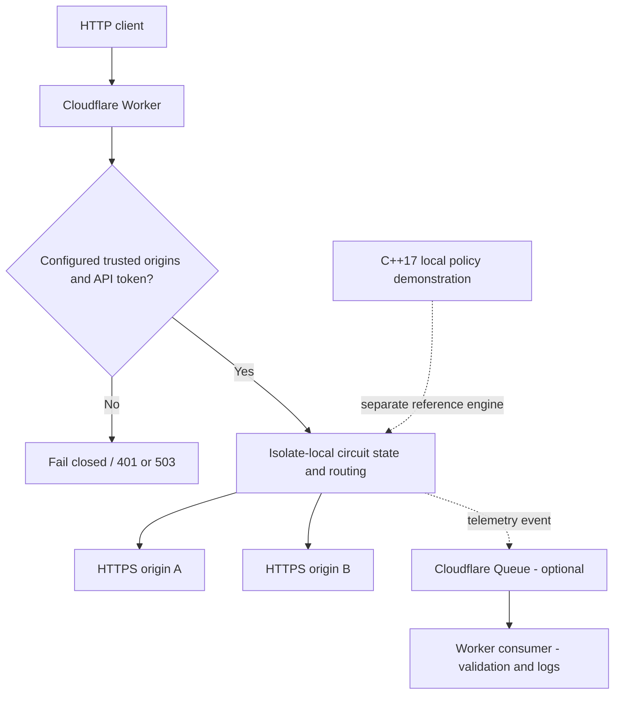

# EdgeGuard Adaptive architecture

This is an independent experimental project. The C++17 policy engine and the Cloudflare TypeScript Worker are **separate implementations**; the Worker does not call into the C++ code.

The public demo exposes only `/` and `/healthz`; forwarding is disabled until explicitly configured. Enabling origin forwarding requires a Cloudflare `API_TOKEN` secret and trusted HTTPS origins.

## Reliability semantics

- Retries are limited to GET and HEAD (the only supported proxy methods), maximum two distinct origins.
- Circuit state exists only within one Worker isolate, not distributed between Worker instances.
- Event messages are best-effort; no persistent deduplication, state coordination or exactly-once claims.
- Response coalescing and caching are **not** currently enabled, to avoid cross-request private-data leakage.
- C++17 runs as a local routing-policy demonstration, not a deployed server.
- Before production use: add Cloudflare Access, rate limits, durable circuit state, privacy-safe cache rules and security testing.
