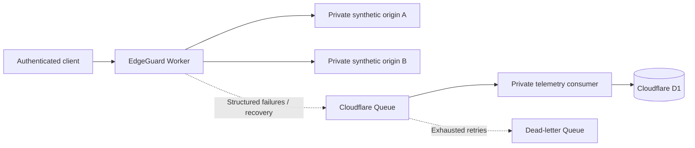

# Durable reliability telemetry — Cloudflare Queues + D1

## Architecture



The **traffic Worker** emits validated, sanitized reliability events to `EVENT_QUEUE`. A **separate queue-only Worker** uses a D1 prepared statement for idempotent inserts. The consumer acknowledges only successful writes and retries transient database failures. A Queue dead-letter queue receives exhausted delivery attempts.

Cloudflare Queues uses at-least-once delivery; `event_id` is the D1 primary key, and `ON CONFLICT(event_id) DO NOTHING` prevents duplicate rows. This is **idempotent persistence**, not exactly-once queue delivery. <https://developers.cloudflare.com/queues/configuration/configure-queues/>

### Recorded fields

- `event_id`, timestamp, type, private origin alias (`origin-a` or `origin-b`), random request UUID, and optional HTTP status.
- No bearer tokens, cookies, user-provided URLs, request bodies, or client IPs.
- The producer currently emits on synthetic origin HTTP 5xx attempts and circuit open/recovery transitions. External hostname labels are **not** published into D1.
- Event publishing is **best effort**. Routing continues if Queue publishing fails; events may be missing. This is not a complete audit log or a guaranteed record of every request.
- D1 retention and deletion policy should be set before using the system with real traffic; this is only a synthetic experimental platform.

### Account setup and billing

**This feature is not activated on the live Worker by committing these files.** The operator must explicitly run [Enable durable reliability telemetry](../.github/workflows/enable-durable-telemetry.yml). The workflow can create **two Cloudflare Queues** and **one D1 database**, apply the SQL schema, deploy the consumer and opt the edge Worker into publishing events.

Cloudflare Queues and D1 can use billable resources or account quotas. Review your plan and pricing before manually running the workflow. Your Cloudflare token must have narrowly scoped permissions for **Workers, Queues and D1**. An existing deployment-only token may not have these extra permissions.

To run it: open the workflow in GitHub Actions, choose `main`, and click **Run workflow**. The workflow uses your existing GitHub repository Cloudflare credentials and the separate `EDGEGUARD_DEMO_BEARER_TOKEN`, without printing their values.

If anything fails, inspect that step's logs; avoid repeating creation blindly. The D1/Queue setup is written to be reusable where existing resources can be detected, but it has **not** yet been tested with your live account.

### Verification

After the opt-in deployment succeeds, send a bounded set of authenticated `GET /demo/fail` requests. Some may route directly to B; those do not emit A failure events. Check D1 remotely with:

```bash
cd telemetry-consumer
npx wrangler d1 execute edgeguard-reliability --remote --command "SELECT event_type, origin, http_status, COUNT(*) AS events FROM reliability_events GROUP BY event_type, origin, http_status ORDER BY events DESC"
```

In GitHub Actions you may need the runtime configuration generated during provisioning; use the provided Cloudflare dashboard D1 SQL console as an alternative. A real durable-ingestion claim requires actual D1 rows and a verified consumer invocation.

### Testing and limitations

Unit tests exercise schema validation, duplicate-event idempotency, successful acknowledgments, transient D1 failures and per-message retries. CI also applies the schema in SQLite. These are **local/CI checks**, not proof of live cloud storage. The separate C++17 routing engine is unchanged.

The standalone [Deploy connected failover demo](../.github/workflows/deploy-connected-demo.yml) workflow deploys the non-telemetry connected profile. Running it later will remove the Queue producer binding; rerun telemetry enablement explicitly if needed.
